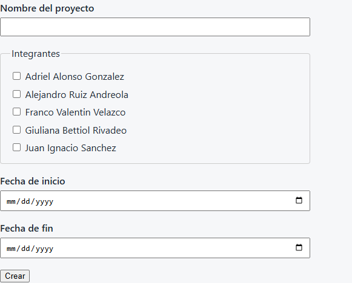

# Manual breve de usuario

## Gestión de Proyectos

Abrí `http://localhost:8080/proyectos` para ver los proyectos existentes y crear uno nuevo. La
pantalla muestra primero los proyectos más recientes, con su nombre, fechas y cantidad de
integrantes.

### Crear un proyecto

1. Escribí el nombre del proyecto.
2. Marcá uno o más integrantes disponibles.
3. Elegí las fechas de inicio y fin.
4. Presioná **Crear**. La fecha de fin debe ser posterior a la fecha de inicio.

Si la creación se completa, aparece **Proyecto creado exitosamente** y el proyecto nuevo queda al
principio de la lista. La creación no selecciona el proyecto activo.

### Corregir errores

Los mensajes de validación aparecen junto al campo que hay que corregir. El formulario conserva los
valores ingresados:

| Mensaje | Qué hacer |
|---|---|
| `project name cannot be empty` | Escribí un nombre; no puede quedar vacío ni contener solo espacios. |
| `El nombre no puede superar los 255 caracteres` | Acortá el nombre. |
| `the member list is required` | Marcá al menos un integrante. |
| `Falta la fecha de inicio` | Ingresá la fecha de inicio. |
| `Falta la fecha de fin` | Ingresá la fecha de fin. |
| `La fecha no tiene un formato válido` | Volvé a elegir la fecha con el control del navegador. |
| `El integrante seleccionado no es válido` | Elegí integrantes que aparezcan en la lista. |
| `La fecha de finalización debe ser posterior a la fecha de inicio` | Corregí la fecha de fin: debe ser posterior a la de inicio. |
| `La operación no pudo completarse` | Hubo un problema al guardar. Intentá nuevamente más tarde. |

Si todavía no hay integrantes cargados, la pantalla informa **No hay integrantes disponibles** y
no permite enviar el formulario.

### Modificar un proyecto

En la lista de **Gestión de Proyectos**, presioná **Modificar** en la fila del proyecto. El
formulario se abre con el nombre, las fechas y los integrantes actuales.

1. Cambiá el nombre o las fechas, o marcá y desmarcá integrantes. Solo aparecen los integrantes que
   ya existen en el sistema.
2. Presioná **Guardar**. Para salir sin cambios, presioná **Cancelar**.

Si se guarda, aparece **Proyecto modificado exitosamente** y volvés a la lista. Si el proyecto es tu
contexto de trabajo, el nombre nuevo se ve arriba sin volver a elegirlo. Se guarda todo junto: si
algo falla, no cambia nada.

Además de los mensajes de la creación, al modificar pueden aparecer:

| Mensaje | Qué hacer |
|---|---|
| `No se puede quitar a [nombre]: tiene horas registradas en este proyecto` | Ese integrante ya cargó horas en historias del proyecto y no se puede quitar. Volvé a marcarlo. |
| `El Sprint N queda fuera de las nuevas fechas del proyecto` | Las fechas nuevas dejan fuera a ese Sprint. Elegí fechas que lo incluyan. |

Si quitás a un integrante que estaba identificado, la próxima vez que navegue se le pide elegir
otro integrante.

## Registro y trazabilidad de defectos

Elegí primero el proyecto desde **Cambiar proyecto** y abrí `http://localhost:8080/defectos`. Para
registrar un defecto, el proyecto debe tener un Sprint activo y una historia relacionada. Completá:

1. **Descripción**: texto de 1 a 1000 caracteres; se eliminan los espacios al principio y al final.
2. **Severidad**: Crítica, Alta, Media o Baja.
3. **Historia relacionada**: cualquier historia del proyecto activo, incluso si está Hecho, pertenece
   a un Sprint finalizado o no tiene Sprint.

Al registrar, el defecto queda **Abierto** y se asocia al Sprint activo como Sprint de detección. La
historia conserva su estado y asignación. La confirmación indica el Sprint utilizado; recargar la
página no vuelve a registrar el defecto ni repite el mensaje.

La lista muestra identificador, descripción, severidad, estado, historia relacionada y Sprints de
detección y resolución. Los defectos más recientes aparecen primero; `—` indica que todavía no hay
Sprint de resolución. Solo se muestran defectos del proyecto activo. Si no hay defectos, la pantalla
muestra **Aún no hay defectos** y permite registrar el primero.

### Errores de registro

Los errores aparecen junto al campo correspondiente y el formulario conserva los valores ingresados.
Si se detectan varios problemas, se muestran juntos y no se guarda el defecto.

| Mensaje | Qué hacer |
|---|---|
| `La descripción es obligatoria` | Escribí una descripción con contenido. |
| `La descripción no puede superar 1000 caracteres` | Acortá la descripción a 1000 caracteres o menos. |
| `La descripción contiene caracteres no válidos` | Quitá los caracteres invisibles o dañados (suelen aparecer al pegar texto copiado de otro programa) y escribí la descripción como texto común. |
| `Seleccione la severidad` | Elegí una de las severidades disponibles. |
| `La severidad no es válida` | Seleccioná una severidad de la lista. |
| `Seleccione la historia relacionada` | Elegí una historia del proyecto activo. |
| `La historia no pertenece al proyecto` | Cambiá a una historia del proyecto activo. |
| `No hay un Sprint activo; no se puede registrar un defecto` | Iniciá un Sprint para el proyecto antes de registrar. |
| `La operación no pudo completarse` | Hubo un problema al guardar. Intentá nuevamente más tarde. |

### Resolver y reabrir defectos

En la columna **Acción** de la lista, cada defecto ofrece una sola acción según su estado:

- **Resolver**, en un defecto **Abierto**: el defecto pasa a **Resuelto** y el Sprint activo queda
  registrado como Sprint de resolución. La confirmación indica el Sprint, por ejemplo
  `Defecto resuelto en el Sprint 2`. El Sprint de resolución no se elige: siempre es el Sprint activo.
- **Reabrir**, en un defecto **Resuelto**: el defecto vuelve a **Abierto** y su Sprint de resolución
  se borra (la lista muestra `—`). La confirmación es `Defecto reabierto`. Reabrir no necesita un
  Sprint activo.

Reabrir un defecto resuelto en un Sprint ya finalizado cambia el conteo de defectos resueltos de ese
Sprint en las métricas.

| Mensaje | Qué hacer |
|---|---|
| `No hay un Sprint activo para registrar la resolución del defecto` | Iniciá un Sprint para el proyecto y volvé a resolver. |
| `El Sprint de resolución no puede ser anterior al Sprint en que se detectó el defecto` | El Sprint activo es anterior al de detección: revisá los Sprints del proyecto. |
| `El defecto ya está resuelto` | No hace falta resolverlo de nuevo; conserva su Sprint de resolución. |
| `El defecto ya está abierto` | El defecto no está resuelto; no hay nada que reabrir. |
| `El defecto no existe` | El defecto no pertenece al proyecto activo o fue eliminado. Volvé a la lista. |
| `La operación no pudo completarse` | Hubo un problema al guardar y el defecto no cambió. Intentá nuevamente más tarde. |

## Registro de esfuerzo

Abrí `http://localhost:8080/esfuerzo` para cargar las horas que trabajaste en una historia del
Sprint activo. Antes elegí el proyecto (**Elegir proyecto**) e identificate (**Identificarme**): si
no lo hiciste, la aplicación te lo pide y después vuelve a esta pantalla. Las horas quedan siempre a
tu nombre.

### Cargar horas

1. Elegí la historia. Solo aparecen las del Sprint activo del proyecto.
2. Revisá la fecha: por defecto es la de hoy y no puede ser posterior.
3. Describí la actividad.
4. Escribí las horas, con coma o punto y hasta dos decimales (más de 0 y hasta 24).
5. Presioná **Registrar horas**.

Si la carga se completa, aparece **Esfuerzo registrado correctamente** y se muestra el historial de
la historia con el total actualizado.

### Ver el historial

Tocá el nombre de una historia en la tabla para ver quién cargó horas, en qué fecha, en qué
actividad y el total. Las cargas más recientes aparecen primero. La tabla de historias muestra las
horas acumuladas de cada una.

### Corregir errores

Todos los errores aparecen juntos, cada uno junto a su campo, y el formulario conserva lo escrito:

| Mensaje | Qué hacer |
|---|---|
| `Seleccione una historia` | Elegí una historia de la lista. |
| `La historia no pertenece al Sprint activo` | Elegí una historia del Sprint activo del proyecto. |
| `La historia no está asignada a un Sprint activo` | El Sprint se cerró mientras cargabas: recargá la pantalla. |
| `La fecha es requerida` | Ingresá la fecha. |
| `La fecha no es válida` | Volvé a elegir la fecha con el control del navegador. |
| `La fecha no puede ser posterior a la fecha actual` | Elegí hoy o una fecha anterior. |
| `La descripción de la actividad es obligatoria` | Describí la actividad. |
| `El valor de horas no es válido` | Escribí un número mayor que 0 y hasta 24, con hasta dos decimales. |
| `La operación no pudo completarse` | Hubo un problema al guardar. Intentá nuevamente más tarde. |

Si el proyecto no tiene un Sprint activo, la pantalla muestra **No hay un Sprint activo** y no
permite cargar horas. La pantalla no permite editar ni borrar cargas.

## Estado del proyecto

Elegí primero el proyecto desde **Cambiar proyecto** y abrí `http://localhost:8080/estado`, o la sección
**Estado del proyecto** del menú. La pantalla es de solo lectura: calcula todo al abrirla, con los datos y la fecha de
ese momento, y no guarda nada. Muestra cuatro cosas del proyecto activo:

1. **Nombre y fechas**: el proyecto y sus fechas de inicio y fin, en formato dd/mm/aaaa.
2. **Estado**: **No iniciado**, **En curso** o **Finalizado**, según la fecha de hoy.
3. **Avance**: **X de Y historias completadas (P %)**, donde X son las historias en Hecho, Y el total de historias del
   proyecto y P el porcentaje con dos decimales y coma (por ejemplo, 4 de 8 es 50,00 %).
4. **Historias por estado**: una tabla con la cantidad de historias en Pendiente, En Sprint, En progreso y Hecho. Un
   estado sin historias muestra 0.
5. **Sprint en curso**: el número del Sprint activo, su objetivo y sus fechas.

### Cómo se calcula el estado

| Estado | Cuándo se muestra |
|---|---|
| No iniciado | Hoy es anterior a la fecha de inicio. |
| En curso | Hoy está entre la fecha de inicio y la de fin; los dos días cuentan. |
| Finalizado | Hoy es posterior a la fecha de fin. |

Se comparan los días, no las horas: el mismo día de inicio o de fin el proyecto ya figura **En curso**. Recargar la
pantalla vuelve a calcular, así que un proyecto puede pasar de En curso a Finalizado al cambiar el día. El estado no
depende de las historias ni de los Sprints.

### Mensajes

| Mensaje | Qué significa |
|---|---|
| `0 de 0 historias completadas (0,00 %)` | El proyecto todavía no tiene historias. |
| `No hay un Sprint en curso` | El proyecto no tiene un Sprint activo; el resto de la información se muestra igual. |
| `Sin proyecto seleccionado` | Primero elegí un proyecto: la aplicación te lo pide y, al elegirlo, vuelve a esta pantalla. |
| `El servicio no está disponible temporalmente` | La base de datos no responde. Intentá de nuevo en unos minutos. |
| `Ocurrió un error inesperado. Intentá nuevamente en unos minutos.` | Hubo un problema al leer los datos; no se muestra información parcial. |
| `La dirección que buscás no existe o ya no está disponible.` | El proyecto elegido ya no existe. Elegí otro. |

## Estimaciones

Elegí el proyecto desde **Cambiar proyecto** y abrí `http://localhost:8080/estimaciones`. La pantalla
lista las historias del proyecto, las más recientes primero, con el título, el estado, los Story Points,
las **horas estimadas** y las **horas reales** registradas en el Registro de esfuerzo. Lo que todavía no
se estimó aparece como **Sin estimar** (nunca como 0); las horas reales aparecen como 0 si nadie cargó
horas.

### Registrar o modificar las horas estimadas

Escribí las horas en el campo de la fila y presioná **Guardar**. Se acepta coma o punto como separador
decimal (`1,5` o `1.5`), con hasta dos decimales y hasta 9999,99 horas, sin separadores de miles. La
primera vez se muestra **Horas estimadas registradas** y las siguientes **Horas estimadas actualizadas**.
Las horas se muestran siempre con coma. Cambiar la estimación no modifica las horas reales ni ningún otro
dato de la historia.

Las historias de un Sprint finalizado (las **Hecho** al cerrar el Sprint) muestran el campo deshabilitado
con el motivo **Sprint finalizado**: su estimación ya no se puede cambiar. Las historias que el cierre
devolvió al Backlog se pueden volver a estimar.

### Corregir errores

- **El valor de horas no es válido**: el valor es 0, negativo, vacío, no numérico o tiene más de dos
  decimales.
- **Las horas estimadas no pueden superar 9999,99**.
- **La historia no existe**: la historia no pertenece al proyecto elegido.
- **La operación no pudo completarse**: no se guardó nada; volvé a intentarlo más tarde.

Ante un error, lo que escribiste queda en el campo para corregirlo y el valor anterior no cambia. Si el
proyecto no tiene historias, la pantalla muestra **Aún no hay historias**.

## Cierre de Sprint

Elegí el proyecto desde **Cambiar proyecto** y abrí `http://localhost:8080/cierre`. La pantalla muestra
el Sprint activo, las historias **Hecho** que permanecerán en el Sprint y las historias **En Sprint** o
**En progreso** que volverán al Backlog en estado **Pendiente**. También muestra los Story Points
completados sobre los planificados.

Antes de confirmar, revisá el resumen: el cierre no se puede deshacer. Al presionar **Cerrar Sprint**,
las historias incompletas pierden su asignación y quedan disponibles para un Sprint posterior; las
historias **Hecho** conservan su estado y su asignación al Sprint finalizado. El sistema guarda además
una foto de los estados y Story Points para las métricas históricas.

Si no hay un Sprint activo, la pantalla informa **No hay un Sprint activo para cerrar**. Si HU-07 detecta
datos inválidos en historias completadas, corregí las historias indicadas antes de reintentar. Un segundo
envío de un Sprint ya cerrado se rechaza; si falla el guardado, no se aplican cambios parciales y se
muestra **La operación no pudo completarse**.

## Métricas del Sprint

Elegí el proyecto desde **Cambiar proyecto** y abrí `http://localhost:8080/metricas`, o la sección **Métricas del
Sprint** del menú. La pantalla es de solo lectura: muestra la velocidad y la desviación de esfuerzo que calcula HU-07
para los Sprints **finalizados** del proyecto activo. Las métricas se calculan al abrir la pantalla y no se guardan.

### Elegir el Sprint

La pantalla muestra la lista de **Sprints finalizados**, del más reciente al más antiguo, con número, Sprint Goal y
fechas (dd/mm/aaaa). Al abrir la pantalla se muestran las métricas del más reciente; hacé clic en otro Sprint de la
lista para ver las suyas (la dirección pasa a ser `/metricas?sprint=ID`). El Sprint elegido queda marcado en la lista.

Un Sprint que todavía está en curso no figura en la lista: arriba se avisa que sus métricas se calculan al cerrarlo
desde **Cierre de Sprint**. Si la dirección trae un Sprint inexistente, en curso o de otro proyecto, se ignora y se
muestra el finalizado más reciente.

### Qué muestra

1. **Velocidad**: los Story Points de las historias **Hecho** del Sprint, por ejemplo `8 Story Points`. Las historias
   que el cierre devolvió al Backlog no cuentan. Un Sprint sin historias Hecho muestra `0 Story Points`.
2. **Desviación de esfuerzo**: (horas reales − horas estimadas) ÷ horas estimadas, con dos decimales, coma y signo.
   Positiva (`+20,00 %`) significa que se trabajó más de lo estimado; negativa (`-8,50 %`), menos; `0,00 %`, lo
   estimado. Las horas estimadas salen de **Estimaciones** y las reales del **Registro de esfuerzo**.
3. **Cálculo parcial**: si alguna historia Hecho no tiene horas estimadas o reales, la desviación se calcula con las
   que sí tienen y aparece la alerta **Cálculo parcial: basado en X de Y historias**. Y cuenta solo las historias
   que quedaron en el Sprint al cerrarlo (las Hecho): el cierre les quita el Sprint a las que no terminaron y las
   devuelve al Backlog, así que esas no aparecen ni en X ni en Y.

### Mensajes

| Mensaje | Qué significa |
|---|---|
| `No disponible` | Ninguna historia Hecho del Sprint tiene horas estimadas: no se puede calcular la desviación. La velocidad se muestra igual. |
| `Cálculo parcial: basado en X de Y historias` | La desviación usa X de las Y historias Hecho; cargá las horas que faltan antes de cerrar el próximo Sprint. |
| `Aún no hay Sprints finalizados` | El proyecto todavía no cerró ningún Sprint. |
| `El Sprint N sigue en curso; sus métricas se calculan al cerrarlo` | El Sprint activo se mide recién cuando se cierra en **Cierre de Sprint**. |
| `Para entrar a esta sección primero elegí un proyecto.` | La aplicación te lleva a elegir el proyecto y después vuelve a esta pantalla. |
| `El servicio no está disponible temporalmente` | La base de datos no responde. Intentá de nuevo en unos minutos. |
| `Ocurrió un error inesperado. Intentá nuevamente en unos minutos.` | Hubo un problema al leer o calcular; no se muestran métricas parciales. |
## Planning Poker

Elegí el proyecto desde **Cambiar proyecto**, identificate como integrante y abrí
`http://localhost:8080/planning-poker`. Ahí se estiman las historias del proyecto en **Story Points** con la serie
1, 2, 3, 5, 8, 13, 21, 34, 55 y 89.

### Abrir una ronda, votar y cerrarla

1. En **Abrir ronda**, elegí la historia y presioná **Abrir ronda**. Aparece en las rondas abiertas con todos los
   integrantes en **Sin votar**.
2. Cada integrante elige un valor y presiona **Votar**. Los demás solo ven que votó (**Votó**), nunca el valor; tu
   propio voto aparece como **Tu voto**. Podés cambiarlo mientras la ronda siga abierta.
3. Cuando votaron todos, presioná **Cerrar ronda**. La ronda pasa a **Rondas cerradas** con los votos revelados y
   un aviso: **Divergencia** si los votos están muy separados (más de dos valores de la serie de distancia), o el
   rango de votos si no la hay.

### Nueva ronda y estimación acordada

En la última ronda cerrada de cada historia aparecen dos acciones:

- **Nueva ronda**: abre la ronda siguiente (ronda 2, 3, …) de la misma historia, sin votos. Usala cuando hubo
  divergencia y el equipo quiere volver a votar después de debatir. La ronda anterior queda en **Rondas cerradas**.
- **Estimación acordada**: elegí el valor y presioná **Registrar estimación**. La historia queda con esos Story
  Points, que se ven en el **Backlog**. Si la ronda tuvo divergencia, el formulario recuerda registrar el valor que
  acordaron después de debatir. Podés registrar directamente si no hubo divergencia, sin abrir otra ronda.

Las rondas cerradas que no son la última de su historia no tienen acciones. Si la historia pertenece a un **Sprint
finalizado**, las dos acciones aparecen deshabilitadas con el motivo **Sprint finalizado**: sus Story Points ya no
se pueden cambiar.

### Mensajes

| Mensaje | Qué hacer |
|---|---|
| `Seleccioná un valor de la serie` | Elegí un valor antes de votar o de registrar la estimación. |
| `El valor no pertenece a la serie de Fibonacci` | Elegí uno de los valores de la serie. |
| `Ya hay una ronda abierta para esta historia` | Votá y cerrá la ronda abierta antes de abrir otra. |
| `La historia ya tuvo una ronda de votación` | Usá **Nueva ronda** desde su última ronda cerrada. |
| `La ronda ya está cerrada` | La ronda se cerró mientras votabas; recargá la pantalla. |
| `La ronda no tiene votos` | Para cerrar una ronda, al menos un integrante tiene que haber votado. |
| `La ronda sigue abierta: cerrala antes de registrar la estimación` | Cerrá la ronda y registrá la estimación desde la ronda cerrada. |
| `Hay una ronda más reciente de esta historia` | La pantalla estaba desactualizada; recargá y usá la última ronda. |
| `La historia pertenece a un Sprint finalizado; sus Story Points no se pueden modificar` | No se puede estimar ni abrir rondas nuevas de esa historia. |
| `La ronda no existe` | La ronda no pertenece al proyecto elegido; recargá la pantalla. |
| `La operación no pudo completarse` | No se guardó nada; volvé a intentarlo más tarde. |

Si no te identificaste, la aplicación te pide elegir un integrante y después vuelve a Planning Poker.
